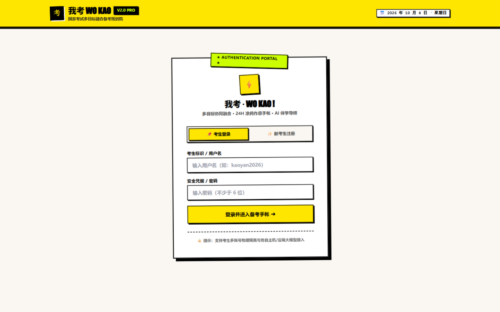
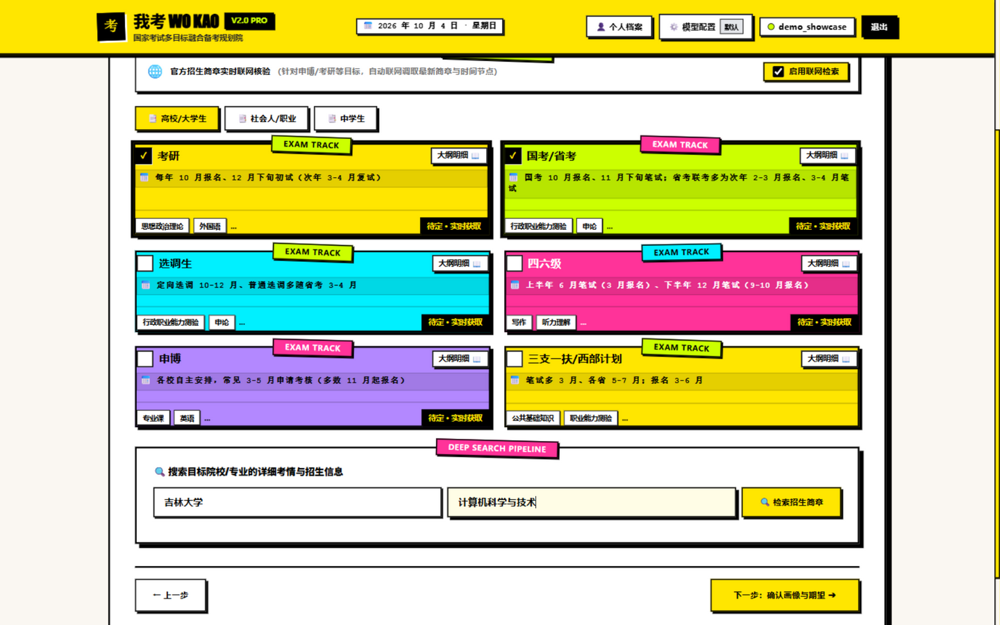
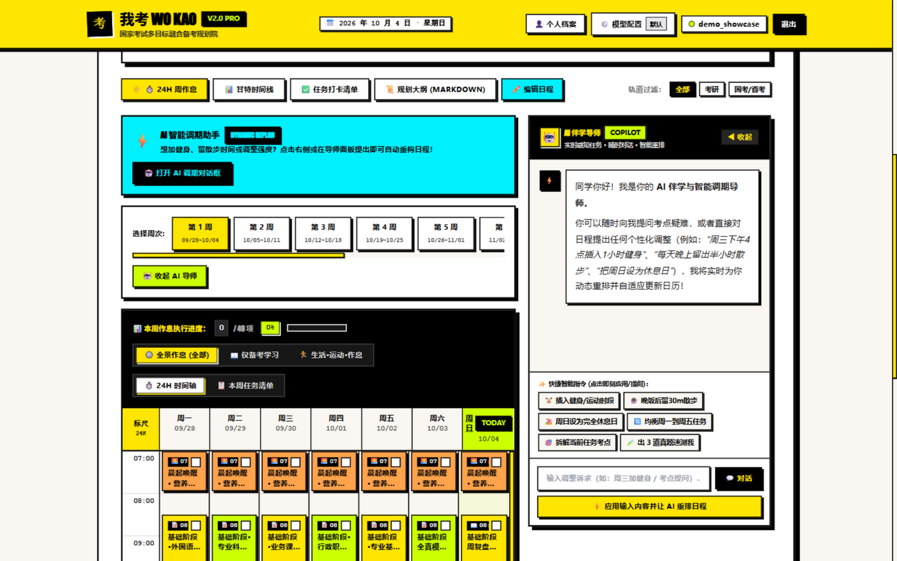
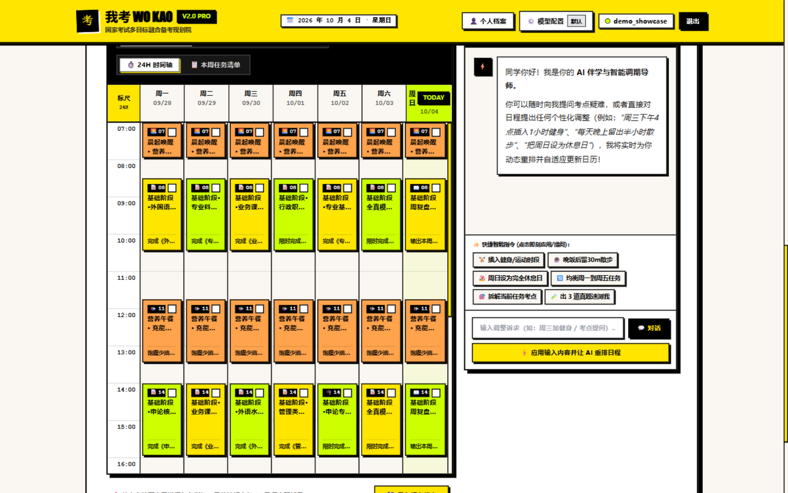
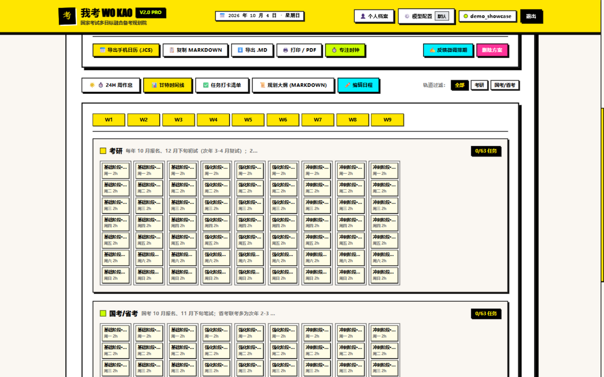
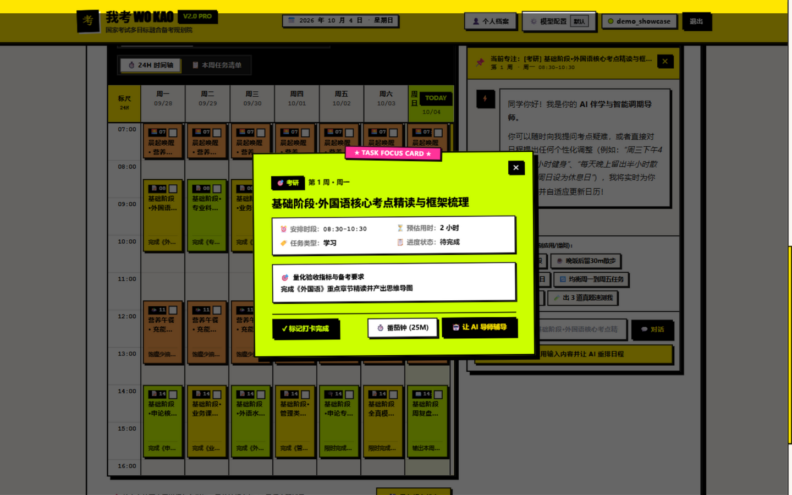
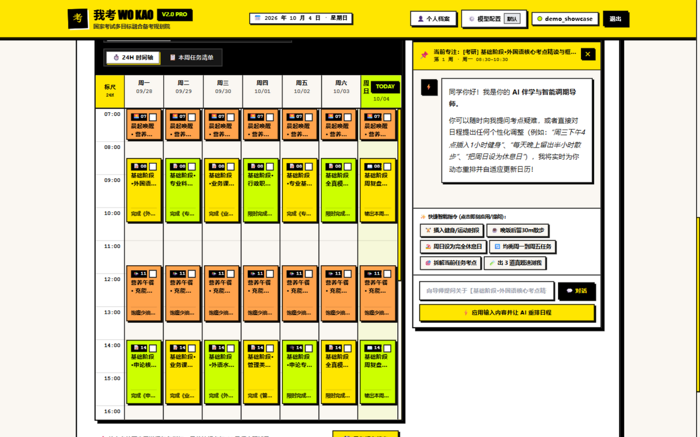
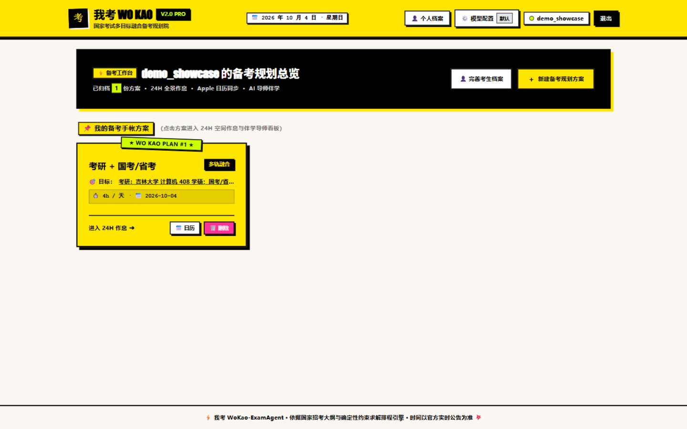

# 我考 WoKao-ExamAgent

<div align="center">


**给多线作战考生的排程手帐：几场考试叠在一起，也能排进同一张 24 小时作息表。**

</div>

考研 12 月底考，国考 11 月底考，省考来年 3 月，申博材料还得尽早联系导师。几场考试叠在一起的时候，普通的待办清单只会提示「时间冲突」，然后让你自己想办法。这个项目的做法是把所有目标、你每天能学的小时数、三餐和睡眠一起丢给一个确定性排程引擎，算出一张 12 周的周作息表。任务该几点开始、和另一场考试抢不抢时间，是算出来的，不是生成的。

## 界面速览

<p align="center">
  
  
</p>
<p align="center">
  
  
</p>
<p align="center">
  
  
</p>
<p align="center">
  
  
</p>

> 都是演示账号的真实运行截图：注册、四步向导、方案看板、24H 作息、AI 导师。

## 工作流程

1. 选考试目标（内置 18 项国家考试大纲：考研、国考/省考、申博、四六级、选调等），填每天能学几小时、在校还是在职；
2. 需要的话联网查一轮最新招生政策，大模型根据政策写任务内容池：学什么、刷什么题、建议多长时间；
3. 排程引擎把内容池落到「周 × 星期 × 时段」的格子上，输出 12 周方案；
4. 看板上可编辑日程、打卡、和 AI 导师对话微调，一键导出日历。

## 几个设计决定

### 排程是约束问题，不是文本生成

这是项目最重要的一条边界。大模型的输出只有任务内容（标题、科目、量化指标、建议时长、目标周次），几点几分干什么由 `wokao/scheduler/engine.py` 计算，且有三条硬约束：任一轨道每天的学习时长不超过配额；同一时刻全局只有一件事；第 1 周锚定创建当周的周一，排期不越过最近的考试日。

模型输出不稳定的时候，坏掉的只是任务措辞，不是时间表。

### 失败就降级，别装没事

API Key 没配、额度用完、JSON 被截断，都会落到同一个兜底内容池，方案照常产出。区别是界面上会明确提示这次没走 AI，日志里留着完整原因。生成接口返回 `degraded` 字段，前端展示降级横幅。我们宁可让你知道降级了，也不端出一份看起来正常的假计划。

### 考情数据来自搜索，不来自模型记忆

科目、分数线、报名时间这类事实性信息全部来自搜索引擎抓取的网页，大模型只负责把用户意图翻译成搜索词。研招网、教育网等官方域名标 S 级，经验社区标 A 级，其余 B 级；每条信息带来源链接，多来源交叉验证后给出置信度。检索结果写 SQLite 缓存，默认 30 天。

### 手帐里不只有学习

时间轴从早排到晚，晨起、三餐、午休、运动、睡前复盘各占一格。视图可以切「全部 / 仅备考学习 / 生活·运动·作息」，任务卡点开有番茄钟和打卡。视觉走的是便利贴和纸胶带风格，不是后台管理系统。

### AI 导师认识你正在看的那张卡

点击任意任务卡后发起对话，导师会带上「第几周、周几、几点到几点、量化指标」这段上下文。可以要它拆考点、出两三道题，也可以说「今天加班太累，挪到周末补」，它会给出重排建议并触发日程重构。

### Key 自带，可存多套随时切换

BYOK：每个账号在设置里填自己的 API Key，任意 OpenAI 兼容端点都能用。内置 DeepSeek、通义千问、智谱 GLM、豆包（火山方舟）、硅基流动、OpenAI 的 Base URL 预设和常用模型名，也支持自定义接口；每个预置都带了申请 Key 的入口链接。

可以给同一账号存多套配置（比如「DeepSeek 主力」「GLM 备用」），哪家的额度用完了，在设置里点一下「启用」就切过去，生成和 AI 导师即刻换模型。Key 用 Fernet 加密存本机，账号之间数据隔离，注册和登录接口有限流。

## 系统架构

```text
WoKao-ExamAgent/
├── wokao/                         # 后端 Python 包
│   ├── config.py                  # 配置加载（环境变量 > config.toml）
│   ├── auth.py                    # PBKDF2 认证与 Session 管理
│   ├── db/                        # SQLite 持久层（WAL、18 项考试大纲预置）
│   │   ├── session.py / models.py / seeds.py / crud.py
│   ├── agents/                    # 内容生成管线与 AI 伴学导师
│   │   ├── prompts.py / parser.py #   Prompt 模板、JSON 截断自愈
│   │   ├── planner.py             #   顺序管线：考情检索 → LLM 内容池 → 引擎落位
│   │   └── coach.py               #   AI 伴学导师对话
│   ├── scheduler/                 # 确定性排程引擎（约束求解核心）
│   │   └── engine.py              #   容量/冲突/考试日锚点落位与兜底内容池
│   ├── security/                  # crypto（BYOK 加密）、rate_limit（认证限流）
│   ├── services/                  # 检索服务层
│   │   ├── search_providers.py    #   多源搜索适配（DuckDuckGo / Tavily / Bing）
│   │   ├── policy_search.py       #   排程前招生政策快查（无 LLM 依赖）
│   │   └── knowledge_retriever.py #   考情深度检索（结构化抽取 + 信任评级 + 缓存）
│   └── api/                       # FastAPI 接口层（routes/ 按业务拆分）
├── frontend/                      # Vue 3 + Vite + Tailwind 前端
│   └── src/                       #   App.vue 主容器 + 17 个组件
├── tests/                         # pytest 全套（conftest 强制临时库隔离，34 用例）
├── docs/                          # PRD / DEVLOG / 复盘 / 问题清单（含修复状态）
├── .github/workflows/tests.yml    # CI：Python 3.10 / 3.13 矩阵跑 pytest
├── server.py                      # 启动入口（uvicorn server:app）
├── start.bat / setup_env.bat      # Windows 一键启动 / 环境初始化
├── setup_env.sh                   # Linux/macOS 环境初始化
└── requirements.txt
```

## 快速开始

### Windows 一键启动

1. 双击 `setup_env.bat` 创建虚拟环境并装依赖，跑一次就行；
2. 双击 `start.bat`。首次运行发现 `frontend/dist` 不存在时会自动 `npm install && npm run build`，然后起服务、开浏览器，地址是 `http://127.0.0.1:8000`。

### 手动启动

```bash
# 后端
python -m venv .venv
source .venv/bin/activate          # Windows: .venv\Scripts\activate
pip install -r requirements.txt

# 前端
cd frontend && npm install && npm run build && cd ..

# 起服务
python -m uvicorn server:app --host 127.0.0.1 --port 8000
```

### 配置模型（可选）

```bash
cp config.example.toml config.toml
```

```toml
OPENAI_API_KEY = "your-api-key"
OPENAI_BASE_URL = "https://api.openai.com/v1"   # 或任意国产兼容网关
OPENAI_MODEL = "gpt-4o-mini"
```

不配置也能用，方案由引擎的兜底内容池产出，界面会说明这一点。也可以之后在网页右上角「模型配置」里按账号单独填 Key。

## API 一览

| 模块 | 方法 | 路径 | 描述 |
| :--- | :--- | :--- | :--- |
| 认证与画像 | `POST` | `/api/auth/register` | 注册（按 IP 限流） |
| | `POST` | `/api/auth/login` | 登录（用户名 + IP 双维限流） |
| | `GET` | `/api/me` | 当前考生信息 |
| | `POST` | `/api/auth/logout` | 注销会话 |
| | `POST` | `/api/profile/resume` | 保存简历纯文本 |
| | `GET` / `PUT` | `/api/profile` | 获取 / 更新考生画像 |
| 大纲与排程 | `GET` | `/api/exams` | 18 项国家考试大纲库 |
| | `GET` | `/api/now` | 服务器日期基准 |
| | `POST` | `/api/generate_fused_plan` | 多目标融合排程 |
| | `GET` / `PUT` / `DELETE` | `/api/plans/{id}` | 计划查询 / 更新 / 删除 |
| | `PUT` | `/api/plans/{id}/schedule` | 保存编辑后的周日程 |
| 导出 | `GET` | `/api/plans/{id}/export.ics` | 导出 iCalendar（内嵌时区） |
| | `GET` | `/api/plans/{id}/export.md` | 导出 Markdown 全文 |
| AI 导师 | `POST` | `/api/agent/chat` | 导师对话（上下文感知） |
| 自定义模型 | `GET/POST/DELETE` | `/api/user/llm_config` | BYOK 多套配置（加密存储，同名覆盖） |
| | `POST` | `/api/user/llm_config/activate` | 一键切换启用的配置 |
| | `POST` | `/api/user/llm_config/test` | 连通性测试 |
| 考情检索 | `POST` | `/api/search_exam_info` | 搜索优先检索（带来源与置信度） |

## 测试

```bash
pytest tests/ -v
```

34 个用例，覆盖融合管线约束、JSON 截断自愈、认证与会话过期、限流器、PBKDF2 新旧格式、BYOK 跨账号隔离、ICS 转义与时区、日程编辑一致性。`tests/conftest.py` 让 pytest 跑在会话级临时数据库上，不会碰你的 wokao.db。推送后 CI 在 Python 3.10 和 3.13 上各跑一遍。

## FAQ

**生成方案时提示「由系统内置排程引擎直接产出」是怎么回事？**

模型调用依赖 BYOK 的 API Key。Key 没配、额度耗尽（403 insufficient_quota）或网络不通时，系统降级为确定性引擎，用兜底内容池出方案。日程结构和约束保证不受影响，恢复 Key 后重新生成即可拿到个性化任务内容。

**一个模型的额度用完了怎么办？**

设置里可以给同一账号保存多套模型配置（内置 GLM、DeepSeek、通义千问、豆包、硅基流动等常见厂商的 Base URL 预设），点「启用」即刻切换到另一家，不用重新填 Key。

**8000 端口被占用？**

`netstat -ano | findstr :8000` 找到 PID，`taskkill /PID <PID> /F` 结束掉，或者换个端口：`python -m uvicorn server:app --port 8001`。

**跑测试会动我的 wokao.db 吗？**

不会。conftest 把 pytest 指到临时数据库和临时密钥文件，和本地数据完全隔离。

**换了电脑或删了 `.wokao_secret.key`，已保存的模型配置打不开？**

Key 的加密密钥就在那个文件里，丢了没法解。删掉它，在「设置」里重新保存各账号的 API Key。

## 路线图

- [ ] 向导中间态刷新恢复（LocalStorage）
- [ ] 非标准 OpenAI 兼容网关的自适应探测
- [ ] 考试库科目分值与考期精细度持续补全
- [ ] 移动端窄屏适配

历史上的问题清单和修复状态在 [docs/问题清单.md](docs/问题清单.md)。

## 许可证

[MIT](LICENSE)。有问题提 Issue，欢迎 PR。
